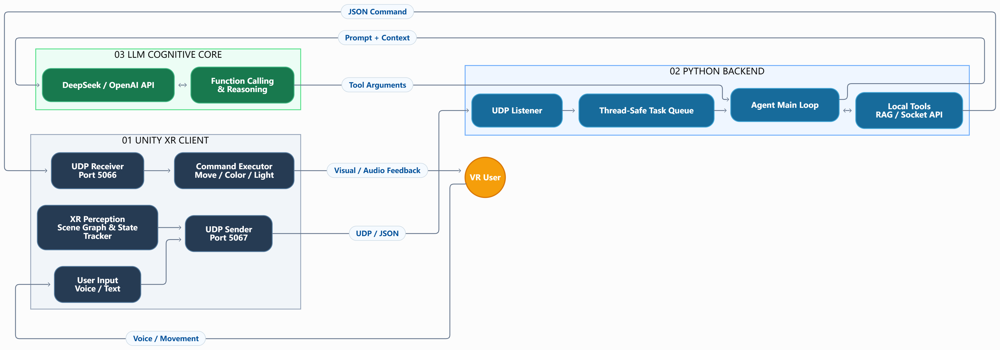

# Embodied LLM Agent for XR

An LLM-powered embodied agent that connects Unity XR environments with a Python backend to enable natural language interaction, scene understanding, and real-time environmental control.

---

## 📌 Overview

This project explores the integration of Large Language Models (LLMs) into immersive XR environments.

Users can interact with the virtual environment through voice or text commands. The LLM agent interprets user intentions, reasons about the current scene, and invokes tools to execute actions inside Unity.

### Core Objectives
- Natural language interaction in XR.
- Scene-aware reasoning and context understanding.
- Tool-based execution of environmental actions.
- Bidirectional communication between Unity and Python.

---

## ✨ Key Features

- **Natural Language Interaction:** Voice and text-based user input.
- **Scene Awareness:** Real-time scene state tracking.
- **LLM Reasoning:** Function Calling and tool orchestration.
- **Environment Control:** Dynamic object movement, color, and lighting.
- **Backend Communication:** UDP-based client-server architecture.

---

## 🏗️ System Architecture

The system consists of three major components:

1. **Unity XR Client** – Handles user interaction, scene perception, and action execution.
2. **Python Backend** – Manages communication, task queues, and agent orchestration.
3. **LLM Cognitive Core** – Performs reasoning and tool selection.



---

## 🛠️ Tech Stack

| Component | Technology |
|---|---|
| XR Environment | Unity 3D |
| XR Interaction | XR Interaction Toolkit |
| Backend | Python |
| Communication | UDP / JSON |
| LLM | DeepSeek / OpenAI API |
| Agent | Function Calling |
| Knowledge Retrieval | RAG |

---

## 📂 Project Structure

```text
project-root/
├── UnityProject/
│   ├── Assets/
│   ├── Packages/
│   └── ProjectSettings/
├── PythonBackend/
│   ├── agent/
│   ├── tools/
│   ├── memory/
│   ├── main.py
│   └── requirements.txt
├── docs/
│   └── images/
│       └── system_architecture.png
├── .gitignore
└── README.md
```

---

## ⚙️ Installation

### Prerequisites

- Unity 2022.3.62f3 LTS or later
- Python 3.13+
- Git
- An OpenAI-compatible API key

### Clone Repository

```bash
git clone https://github.com/USERNAME/REPOSITORY.git
cd REPOSITORY
```

### Setup Python Backend

```bash
cd PythonBackend
python -m venv .venv
```

Activate the environment:

Windows:
```bash
.venv\Scripts\activate
```

macOS / Linux:
```bash
source .venv/bin/activate
```

Install dependencies:

```bash
pip install -r requirements.txt
```

---

## 🚀 Getting Started

1. Open the Unity project.
2. Configure the Python backend and API credentials.
3. Start the Python server.
4. Run the Unity XR application.
5. Interact with the virtual environment using voice or text commands.

---

## 🔄 Communication Protocol

| Direction | Port | Description |
|---|---:|---|
| Unity → Python | 5066 | User input and scene state |
| Python → Unity | 5067 | AI-generated commands |

Messages are exchanged using JSON over UDP.

---

## 📸 Demo

Coming Soon.

---

## 🗺️ Roadmap

- [x] Unity-Python UDP communication
- [x] Basic LLM API integration
- [ ] Structured Output validation
- [ ] Function Calling tool registry
- [ ] Scene-aware RAG
- [ ] XR embodied agent interaction
- [ ] Multi-agent collaboration
- [ ] User study and evaluation

---

## 🤝 Contributing

Contributions, ideas, and feedback are welcome.

---

## 📄 License

To be determined.
